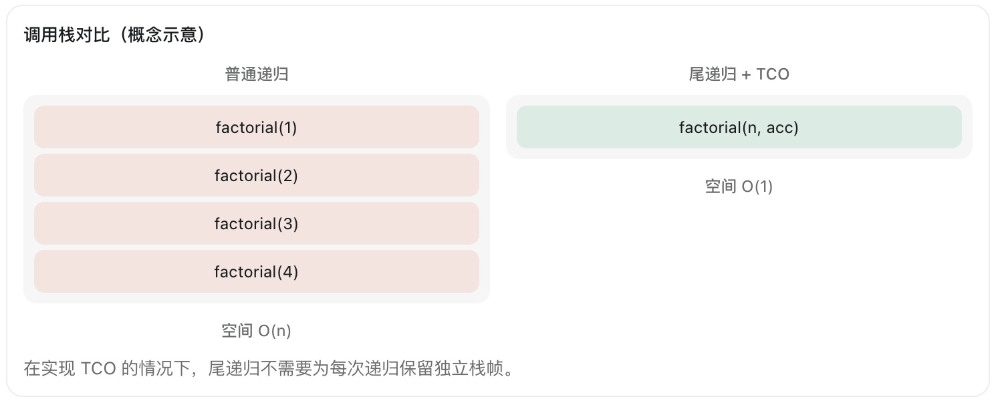

# 尾调用优化（Tail Call Optimization, TCO）

尾递归（Tail Recursion） 是一种特殊的递归形式，而 TCO（Tail Call Optimization，尾调用优化） 是编译器或运行时用于优化尾调用的技术。

你提到的 TOC 应该是指 TCO。

## 1. 什么是尾递归？

尾递归的核心条件是：递归调用是函数执行的最后一个操作，递归返回后不再进行额外计算。

以阶乘为例。

### 普通递归

```
function factorial(n) {
  if (n <= 1) return 1;
  return n * factorial(n - 1);
}
```

执行 `factorial(4)`：

```
factorial(4)
  4 * factorial(3)
        3 * factorial(2)
              2 * factorial(1)
                    1
```

这里 `factorial(n - 1)` 返回后，还需要执行乘法，因此不是尾递归。

### 尾递归

```
function factorial(n, acc = 1) {
  if (n <= 1) return acc;
  return factorial(n - 1, n * acc);
}
```

执行 `factorial(4)`：

```
factorial(4, 1)
  ↓
factorial(3, 4)
  ↓
factorial(2, 12)
  ↓
factorial(1, 24)
  ↓
24
```

这里递归调用是函数最后一个操作，不需要等待子函数返回后继续计算，因此属于尾递归。

## 2. 什么是 TCO？

普通递归每调用一次函数，通常都需要创建新的调用栈帧（Stack Frame）。

TCO 允许编译器或运行时在满足条件时，复用当前栈帧或采用等效方式执行尾调用，避免调用栈不断增长。



在实现 TCO 的情况下，尾递归不需要为每次递归保留独立栈帧。

| 比较        | 普通递归 | 尾递归 + TCO |
| --------- | ---- | --------- |
| 时间复杂度     | O(n) | O(n)      |
| 调用栈空间     | O(n) | O(1)      |
| 栈溢出风险     | 较高   | 显著降低      |
| 是否依赖运行时优化 | 否    | 是         |

注意：尾递归不等于一定会触发 TCO。

## 3. 不同语言对 TCO 的支持

| 语言         | TCO 支持情况                    |
| ---------- | --------------------------- |
| JavaScript | 规范规定了严格条件下的尾调用优化，但主流 V8 不支持 |
| Java       | JVM 不提供通用 TCO 保证            |
| Kotlin     | 使用 `tailrec` 编译为循环（符合条件时）   |
| Rust       | 不保证 TCO                     |
| C / C++    | 编译器可能优化，但不保证                |
| Python     | 不支持 TCO                     |

例如 Kotlin：

```kotlin
tailrec fun factorial(
    n: Int,
    acc: Long = 1
): Long {
    if (n <= 1) return acc
    return factorial(n - 1, n * acc)
}
```

Kotlin 编译器可以将符合条件的 `tailrec` 函数转换成类似下面的循环：

```kotlin
fun factorial(n: Int): Long {
    var current = n
    var acc = 1L

    while (current > 1) {
        acc *= current
        current--
    }

    return acc
}
```

这实际上避免了递归调用栈的增长。

## 4. TCO 和尾递归的区别

需要区分三个概念：

- Tail Call（尾调用）：函数最后一个操作是调用另一个函数。
- Tail Recursion（尾递归）：尾调用的目标是自身。
- TCO（尾调用优化）：编译器或运行时优化尾调用，避免栈帧持续增长。

因此：

尾递归是一种代码结构，TCO 是一种优化机制。

对于 JavaScript、Java、Rust 开发，如果递归深度可能很大，通常更推荐显式使用 `while` / `for` 循环，而不是依赖 TCO。
